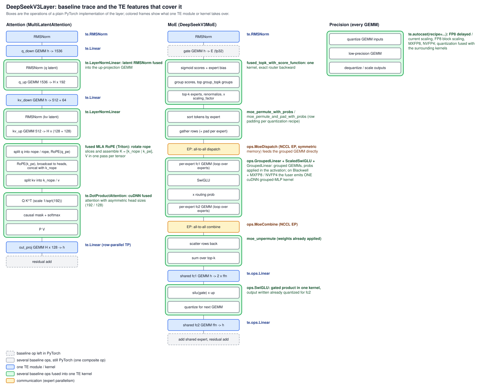
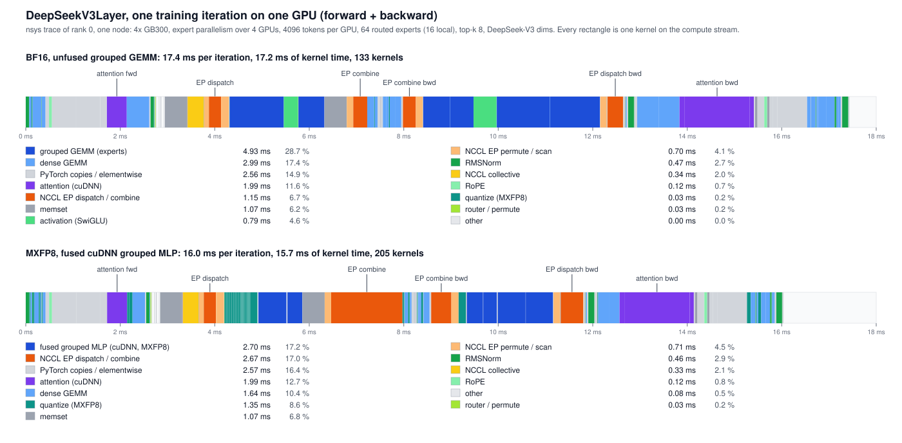

..
    Copyright (c) 2022-2026, NVIDIA CORPORATION & AFFILIATES. All rights reserved.

    See LICENSE for license information.

DeepSeek-V3
===========

:class:`~transformer_engine.pytorch.models.DeepSeekV3Layer` is a drop-in
analogue of :class:`~transformer_engine.pytorch.TransformerLayer` for the
DeepSeek-V3 architecture: pre-RMSNorm, multi-latent attention (MLA),
residual, pre-RMSNorm, dense MLP or DeepSeek MoE, residual. The first layers
of DeepSeek-V3 are dense (``num_experts=None``), the rest use the MoE.

Features used
-------------

The diagram traces one layer as a plain PyTorch implementation would run
it, operation by operation, and marks which Transformer Engine module or
kernel takes each group of operations over.

Attention (:class:`~transformer_engine.pytorch.models.MultiLatentAttention`)

* :class:`~transformer_engine.pytorch.DotProductAttention` with asymmetric
  head sizes (``kv_channels=(192, 128)``), which selects the cuDNN fused
  attention backend for the MLA shapes.
* Fused MLA RoPE kernels (:func:`~transformer_engine.pytorch.attention.mla_rope.apply_mla_rope_q`,
  :func:`~transformer_engine.pytorch.attention.mla_rope.apply_mla_rope_kv`)
  that rotate the rope slice and assemble the key and value tensors in one
  pass, with optional YaRN context extension
  (:func:`~transformer_engine.pytorch.attention.mla_rope.build_rope_tables`).
* :class:`~transformer_engine.pytorch.LayerNormLinear` with RMSNorm, so the
  latent normalizations are fused into the up-projections;
  :class:`~transformer_engine.pytorch.Linear` with column and row tensor
  parallelism for the projections.

MoE (:class:`~transformer_engine.pytorch.models.DeepSeekV3MoE`)

* :ref:`Fused router <moe-router>`
  (:func:`~transformer_engine.pytorch.router.fused_topk_with_score_function`):
  sigmoid scores, aux-loss-free expert bias and node-limited grouped top-k in
  one kernel; :ref:`load balancing <moe-load-balancing>` through
  ``update_expert_bias()``.
* :ref:`Token permutation <moe-token-permutation>`
  (:func:`~transformer_engine.pytorch.moe_permute_with_probs`,
  :func:`~transformer_engine.pytorch.moe_permute_and_pad_with_probs`,
  :func:`~transformer_engine.pytorch.moe_unpermute`), padding each expert's
  rows to the alignment the active quantization recipe needs.
* Experts as an :doc:`operation fuser </examples/op_fuser/op_fuser>` sequence
  :class:`~transformer_engine.pytorch.ops.GroupedLinear` ->
  :class:`~transformer_engine.pytorch.ops.ScaledSwiGLU` ->
  :class:`~transformer_engine.pytorch.ops.GroupedLinear`, with the routing
  probabilities applied inside the activation. On Blackwell GPUs with MXFP8 or
  NVFP4 the fuser replaces the three operations by the
  :ref:`fused grouped MLP <moe-grouped-mlp>` kernel
  (``NVTE_CUTEDSL_FUSED_GROUPED_MLP=1``).
* :ref:`Expert parallelism <moe-expert-parallelism>` over NCCL
  (:class:`~transformer_engine.pytorch.ops.MoeDispatch`,
  :class:`~transformer_engine.pytorch.ops.MoeCombine`,
  :func:`~transformer_engine.pytorch.ep.ep_bootstrap`), fused with the expert
  sequence so dispatch and combine feed the grouped GEMM directly.
* Shared expert as a dense ``Linear -> SwiGLU -> Linear`` operation sequence:
  the GEMMs stay separate kernels, while :class:`~transformer_engine.pytorch.ops.SwiGLU`
  computes the gated product in one kernel and writes it directly in the
  quantized format the next GEMM consumes.

Precision

* Every GEMM runs under :class:`~transformer_engine.pytorch.autocast` with any
  :doc:`low-precision recipe </features/low_precision_training/index>`
  (FP8 delayed and current scaling, FP8 block scaling, MXFP8, NVFP4).

Usage
-----

The natural way to run the layer is with the routed experts sharded over all
GPUs (expert parallelism) and the dense parts replicated or sharded by the
surrounding framework. One process per GPU, launched with ``torchrun``:

.. code-block:: python

    import os
    import torch
    import torch.distributed as dist
    import transformer_engine.pytorch as te
    from transformer_engine.pytorch.ep import ep_bootstrap, ep_finalize
    from transformer_engine.pytorch.models import DeepSeekV3Layer, DeepSeekV3MoE

    local_rank = int(os.environ["LOCAL_RANK"])
    torch.cuda.set_device(local_rank)
    dist.init_process_group("nccl", device_id=torch.device("cuda", local_rank))
    ep_group = dist.new_group(backend="nccl")  # every rank; one expert group
    ep_size = dist.get_world_size(ep_group)

    hidden, topk = 7168, 8
    num_local_experts = 32            # 256 experts on 8 GPUs
    num_experts = num_local_experts * ep_size
    tokens_per_rank = 4096            # upper bound on local tokens per forward

    # NCCL EP: once per process, before building any EP module.
    ep_bootstrap(
        ep_group,
        num_experts=num_experts,
        max_tokens_per_rank=tokens_per_rank,
        hidden_dim=hidden,
        num_topk=topk,
        recv_capacity_per_rank=DeepSeekV3MoE.ep_recv_capacity(
            ep_size, tokens_per_rank, topk, num_local_experts
        ),
    )

    layer = DeepSeekV3Layer(
        hidden_size=hidden,
        num_attention_heads=128,
        num_experts=num_experts,
        moe_ffn_hidden_size=2048,
        topk=topk,
        num_groups=8,
        group_topk=4,
        shared_expert_ffn_hidden_size=2048,
        params_dtype=torch.bfloat16,
        ep_group=ep_group,
        ep_max_tokens_per_rank=tokens_per_rank,
    )
    ep_buffer = layer.mlp.make_ep_buffer()  # reuse across steps

    x = torch.randn(tokens_per_rank // 4, 4, hidden, dtype=torch.bfloat16, device="cuda")
    for step in range(num_steps):
        with te.autocast(recipe=te.MXFP8BlockScaling()):
            y = layer(x, ep_buffer=ep_buffer)
        y.sum().backward()
        optimizer.step()
        optimizer.zero_grad()
        # Aux-loss-free load balancing: token counts must be summed over the
        # ranks that saw different tokens (here: the whole EP group).
        dist.all_reduce(layer.mlp._last_tokens_per_expert, group=ep_group)
        layer.mlp.update_expert_bias()

    ep_finalize()
    dist.destroy_process_group()

.. code-block:: bash

    torchrun --nproc-per-node=8 train.py

Notes:

* Every rank owns ``num_experts // ep_size`` experts; ``ep_max_tokens_per_rank``
  bounds the local tokens of one forward and sizes the receive buffers.
  Tokens are exchanged in bf16, so the input of an EP layer must be bf16.
* An ``EpBuffer`` holds one forward's routing state until its backward has
  run; reuse one buffer per layer, or let the layer create one per call.
* Tensor parallelism of the attention is independent: pass ``tp_group`` /
  ``tp_size`` and the MLA up- and output projections are column- / row-sharded.
* Without ``ep_group`` the same layer runs all experts locally; this is the
  single-GPU and test configuration. ``examples/pytorch/deepseek_v3`` is a
  complete expert-parallel benchmark with a plain-PyTorch baseline.

Where the time goes
-------------------

All numbers are for one ``DeepSeekV3Layer`` with DeepSeek-V3 dimensions
(hidden 7168, 128 heads, MLA 1536 / 512 / 128 / 64 / 128, expert ffn 2048,
shared expert ffn 2048), top-k 8, 4096 tokens per GPU, forward + backward,
bf16 unless noted. Timings are wall-clock with CUDA synchronization, no CUDA
graphs. Reproduce them with ``examples/pytorch/deepseek_v3``; the full setup
(software versions, environment variables) is in that example's README.

One iteration on one node
^^^^^^^^^^^^^^^^^^^^^^^^^

An ``nsys`` trace of rank 0 on one GB300 node (4 GPUs, expert parallelism
over all four, 64 routed experts, top-k 8, 4096 tokens per GPU), redrawn as
one forward + backward iteration of the layer. Every rectangle is one kernel
on the compute stream; the tables sum the kernel time per group.

The trace is from an earlier revision of the layer than the tables below:
the two grey groups, PyTorch copies (the concatenations that assembled the
MLA key and value tensors) and memsets (zeroing the EP receive buffers), have
since been removed by the fused MLA RoPE kernels and the EP buffer changes,
which is where most of the gap between these 16-17 ms and the 9.5-12.4 ms
below comes from. What remains is the shape of the layer: the expert GEMMs
(or the fused grouped MLP), the two NCCL EP exchanges in each direction, the
cuDNN attention and the dense MLA projections. In the MXFP8 variant the fused
grouped MLP takes 2.7 ms instead of 4.9 ms of grouped GEMMs plus 0.8 ms of
SwiGLU, at the price of 1.4 ms of quantization kernels; the forward EP
combine is long because the first collective after the experts absorbs the
load imbalance between ranks.

TE MoE vs. plain PyTorch MoE
^^^^^^^^^^^^^^^^^^^^^^^^^^^^

Same layer, 8 local experts per GPU, only the MoE block differs. ``naive``
is an expert-parallel MoE written in plain PyTorch (``all_to_all_single``
dispatch and combine, a Python loop over the local experts with dense SwiGLU
MLPs); ``naive_grouped`` keeps the all-to-all but runs the experts as one TE
grouped GEMM; ``te`` is ``DeepSeekV3MoE`` with NCCL expert parallelism.
Median of three runs, ms per iteration.

.. list-table::
   :header-rows: 1

   * - MoE implementation
     - 4 GB200 (32 experts)
     - 4 GB300 (32 experts)
     - 8 GB300 (64 experts)
   * - ``naive``: all_to_all + loop over experts
     - 28.61
     - 27.21
     - 27.70
   * - ``naive_grouped``: all_to_all + TE grouped GEMM
     - 17.79
     - 16.72
     - 17.13
   * - ``te``: NCCL EP + grouped GEMM
     - 13.68
     - 12.37
     - 14.09
   * - ``te``, MXFP8 (unfused grouped GEMM)
     - 10.99
     - 10.32
     - 12.11
   * - ``te``, MXFP8 fused grouped MLP
     - 10.11
     - 9.49
     - 10.45

Global throughput of the ``te`` variants, in millions of tokens per second:

.. list-table::
   :header-rows: 1

   * - Precision
     - 4 GB200
     - 4 GB300
     - 8 GB300
   * - BF16
     - 1.20
     - 1.33
     - 2.32
   * - MXFP8
     - 1.49
     - 1.59
     - 2.71
   * - MXFP8 fused
     - 1.62
     - 1.73
     - 3.14

Kernel breakdown of the fastest variant
^^^^^^^^^^^^^^^^^^^^^^^^^^^^^^^^^^^^^^^

``te``, MXFP8 fused grouped MLP, 8 GB300: per GPU and iteration, from
``nsys stats --report cuda_gpu_kern_sum`` (10.8 ms of kernel time; 10.5 ms
per iteration without the profiler; no memsets or copies left).

.. list-table::
   :header-rows: 1

   * - Group
     - ms
     - Kernels
   * - NCCL EP all-to-all
     - 2.3
     - dispatch (1.05) and combine (1.29), each twice per iteration (fwd + bwd)
   * - NCCL EP local permute
     - 0.6
     - staging buffer to expert-major layout, zero-filled padding
   * - rank skew wait
     - 0.5
     - routing-map all-gather absorbs load imbalance between ranks
   * - fused grouped MLP (cuDNN, MXFP8)
     - 2.4
     - fc1 + SwiGLU fwd (0.53), fc2 fwd (0.82), dGLU bwd (0.31), wgrad (0.78)
   * - MXFP8 quantization
     - 1.1
     - recv buffer (0.4), dense GEMM inputs (0.7)
   * - dense MXFP8 GEMMs
     - 1.4
     - MLA projections, shared expert
   * - attention (cuDNN fused)
     - 0.9
     - fprop (0.18), bprop (0.51), dq / dO helpers
   * - RMSNorm, RoPE, residual adds
     - 0.8
     - rmsnorm (0.39), MLA RoPE (0.18), adds (0.2)

For comparison, ``naive`` spends 3.4 ms in all-to-all, 6.5 ms in eight
separate GEMM pairs and about 12 ms in indexing, zero-fills, copies and adds;
``naive_grouped`` removes the loop (about 10.5 ms) and NCCL EP removes the
remaining all-to-all plus sort / gather / scatter overhead (2.9 ms on 8 GPUs).

Other implementations of the same layer
^^^^^^^^^^^^^^^^^^^^^^^^^^^^^^^^^^^^^^^

Measured with an earlier revision of ``DeepSeekV3Layer`` (before the EP
buffer and alignment changes above), 64 routed experts, top-k 8, sequence
length 4096, ms per layer, forward + backward.

.. list-table::
   :header-rows: 1

   * - Implementation
     - Setup
     - ms / layer
     - Speedup
   * - Hugging Face ``DeepseekV3DecoderLayer`` (SDPA, bf16)
     - 1 GB300, no EP
     - 56.4
     - 1x
   * - ``DeepSeekV3Layer`` (bf16)
     - 1 GB300, no EP
     - 13.8
     - 4.1x
   * - TorchTitan DeepSeek-V3 layer (FSDP2 + EP all-to-all, FlexAttention, ``torch._grouped_mm``)
     - 4 GB300, EP 4, 4096 tokens per GPU
     - ~54
     - 1x
   * - ``DeepSeekV3Layer`` (bf16)
     - 4 GB300, EP 4, 4096 tokens per GPU
     - 15.1
     - 3.6x
   * - ``DeepSeekV3Layer`` (MXFP8, fused grouped MLP)
     - 4 GB300, EP 4, 4096 tokens per GPU
     - 12.1
     - 4.4x

The Hugging Face layer and ``DeepSeekV3Layer`` were loaded with the same
weights; forward outputs and input gradients agree to bf16 precision. The
TorchTitan time is the difference between 8-layer and 4-layer models divided
by four, so it includes TorchTitan's per-layer FSDP2 all-gather and
reduce-scatter (``dp_shard=4``), which the TE benchmark does not perform.
